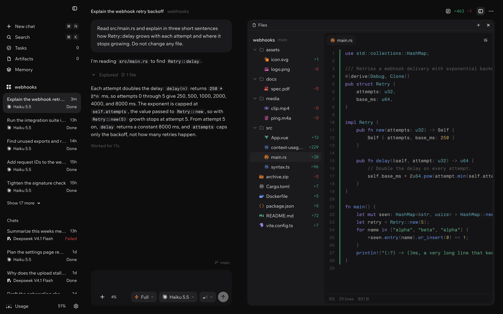
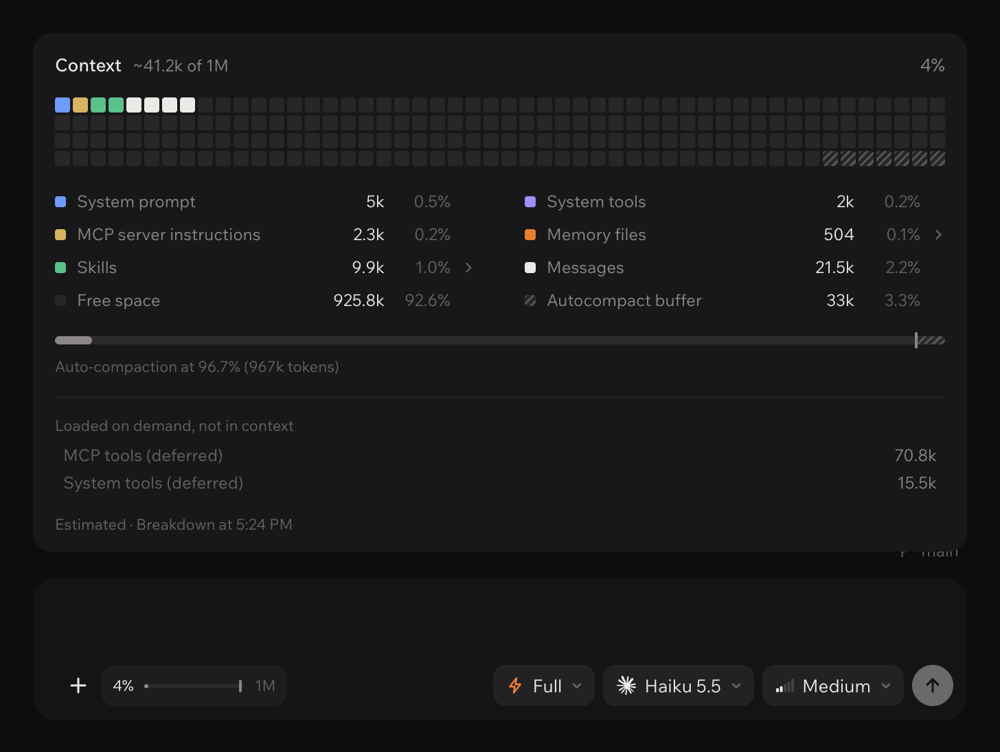

<p align="center">
  <picture>
    <source media="(prefers-color-scheme: dark)" srcset="assets/odla-logo-dark.svg">
    
  </picture>
</p>

<h3 align="center">The agentic development environment, built to be the best in the world.</h3>

<p align="center">
  Claude Code, Codex and Pi, made better. Shared memory, subagents that talk to each other,<br>
  and the files, terminal and browser in one fast, focused window.
</p>

<p align="center">
  <a href="https://github.com/zqkra/odla-releases/releases/latest"></a>
  
  <a href="https://github.com/zqkra/odla-releases/releases"></a>
</p>

<p align="center">
  <a href="https://github.com/zqkra/odla-releases/releases/latest"><strong>Download Odla for Mac</strong></a>
  &nbsp;·&nbsp;
  <a href="#install">Install</a>
  &nbsp;·&nbsp;
  <a href="https://github.com/zqkra/odla-releases/issues/new/choose">Report a bug</a>
</p>

<br>

<p align="center">
  
</p>

## Why Odla

A coding agent is only as good as what surrounds it: what it remembers, what it knows about your project, how it hands work to other agents and how you see what it did. Odla is built around that. It takes the agents you already use and gives every one of them the same memory, the same skills and the same rules, then puts everything they touch in one window.

- **Fast.** Opens in under a second on Apple silicon. Long chats load their history as you scroll, and the app stays light while your agents work. Heavy viewers such as PDF and charts load only when you open them.
- **Focused.** One primary action per screen, no automation clutter, and quiet states that only tell you what changed.
- **Honest.** You always see what an agent is doing, what is left on its task list, how full its context is and what it changed before you merge.
- **Native.** Liquid glass that follows the System theme, a sidebar that floats out from the edge, smooth motion and keyboard shortcuts that feel at home on a Mac.

## Memory, built in

Your agents share one long-term memory, and you own it. It is a private Git repository of Markdown notes that syncs across your machines, not a cloud service and not a plugin.

- **It sets itself up.** On first launch Odla creates your memory, and with a one-time code it backs every note up to a private GitHub repository.
- **Every agent remembers.** Each chat gets the memory skill, whatever the harness. Agents search and read notes when they need them and save decisions, shipped work and lessons when they happen.
- **No wasted context.** Nothing is loaded at the start of a chat. An agent opens memory only when the task calls for it.
- **Ask your memory.** Ask a question and get an answer that cites the notes it came from, each one a click away.
- **See what you know.** A constellation of your notes and how they link, plus what was learned this week.
- **It keeps itself tidy.** An organizer agent cleans up and links your notes every week, or whenever you ask.

## Every agent, made better

Odla adds the same layer to every harness, so Claude Code, Codex and Pi all work the Odla way.

- **Plans and tickets without asking.** Before multi-step work, agents write a plan, split it into tickets and move each ticket as the work moves. Decisions become specs, reviews and notes you can read later.
- **Answers you can read at a glance.** Agents pick the right form for each idea: a table, a real chart, a diagram or one plain sentence. Every image an agent opens shows up in the chat.
- **Shared skills.** Memory, orchestration, browser control, charts and tickets reach every agent, whatever the harness.
- **A real browser.** Agents open, read, click and type in Odla's own browser to check their work, and you watch it happen in a floating view.
- **Never stuck on limits.** When a subscription window runs out, Odla queues the turn and sends it again when the window reopens. Overloaded providers are retried with backoff, and a pending retry survives a restart.
- **Task lists you can see.** Agents keep a task list with phases. The task in progress shows above the composer, the full list opens with one click, and Odla reminds an agent that stops with open tasks.
- **One set of permissions.** Choose Ask, Edit, Build or Full, and Odla maps it to each harness's own permission model.

## Many agents, one window

- **Subagents first.** A parent agent opens children and briefs them. Children report back to their parent, and siblings can talk to each other when you allow it.
- **See the orchestration.** The map shows who opened whom and what each agent is doing right now.
- **Steer at any time.** A message sent while an agent works reaches the running turn. Queue the next one or stop with a click.
- **Switch agents mid-conversation.** Pick a model from another harness and the work continues in a new chat with the full conversation as context.
- **Native commands.** Each harness's slash commands work right in the composer.

## Everything in one place

- **Files.** Type icons, syntax colours, wrapped lines, and previews for images, SVG, PDF, video, audio and Markdown.
- **Terminal.** The chat's own shell, in the project folder.
- **Review.** Every change an agent makes, as a diff, before it lands.
- **Context meter.** How full each agent's context window is, what fills it and where auto-compaction starts.

  

- **Usage.** Your agent subscriptions and their limits at a glance.
- **Composer.** Word suggestions learned from your own prompts, Tab to accept, and the model, effort and autonomy for each chat.
- **Computer use (experimental).** Turn it on in Settings > General > Experimental and agents can drive a Mac app in the background, without taking your pointer or bringing the app to the front.

## Install

1. Download `Odla-<version>-arm64.dmg` from the [latest release](https://github.com/zqkra/odla-releases/releases/latest).
2. Open it and drag Odla into the Applications folder.
3. Open Odla. Because this build is not notarized by Apple yet, macOS stops the first launch and says it could not verify the app. Allow it once, either way:
   - Open **System Settings > Privacy & Security**, scroll to **Security** and click **Open Anyway** next to Odla, or
   - run this in Terminal:

     ```sh
     xattr -dr com.apple.quarantine /Applications/Odla.app
     ```

4. Odla walks you through the first launch: connect your agents, add your projects and set up your memory. Then start a chat.

To check that the download is intact, compare its checksum with `SHA256SUMS.txt` from the same release:

```sh
shasum -a 256 ~/Downloads/Odla-*-arm64.dmg
```

## Requirements

| | |
| --- | --- |
| Mac | Apple silicon (M1 or later). Intel Macs are not supported. |
| macOS | 13 Ventura or later |
| Agent | An account with at least one supported agent, for example Claude Code or Codex |
| Memory | Nothing to install: Odla creates it on first launch. It needs Git, which comes with Apple's developer tools; Odla offers to install them if they are missing. Backup to GitHub is optional. |

## Update

Odla checks for new versions on its own. When one is out, a card appears at the bottom of the sidebar; click it to download the new installer, then quit Odla and replace the app in the Applications folder. You can also check in **Settings > General > Version**. Your chats and settings stay in `~/.odla`.

## Uninstall

Quit Odla and move it to the Trash. To delete your chats and settings as well, remove `~/.odla` and `~/Library/Application Support/Odla`. Your memory repository is yours and stays where it is.

## Feedback

Odla is in early testing, and every report helps. [Open an issue](https://github.com/zqkra/odla-releases/issues/new/choose) with your macOS version, the Odla version (Odla > About Odla) and the steps that lead to the problem.

## License

The builds in this repository are provided for testing. Odla includes open source software, listed with its licenses in [THIRD_PARTY_NOTICES.md](THIRD_PARTY_NOTICES.md).
